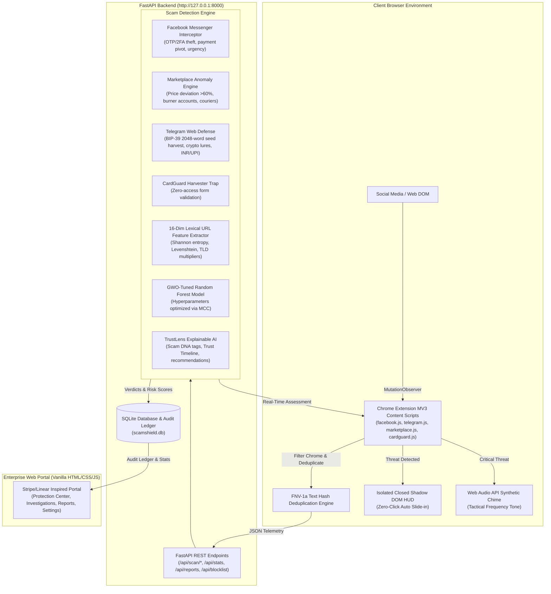

# ScamShield AI — Enterprise Real-Time Browser Scam & Threat Interception

[](https://fastapi.tiangolo.com)
[](https://python.org)
[](https://developer.chrome.com/docs/extensions/mv3/)
[]()
[]()

**ScamShield AI** is an enterprise-grade, real-time browser scam interception platform built to protect users directly at the point of interaction. It combines high-speed behavioral heuristic engines, lexical machine learning classifiers tuned via **Grey Wolf Optimization (GWO)**, and an isolated **Closed Shadow DOM HUD** to intercept high-frequency social engineering scams across **Facebook Messenger, Facebook Marketplace, Telegram Web (`/a/` and `/k/`), and open-web credential/card harvesters**.

---

## 1. System Architecture



---

## 2. Key Modules & Feature Matrix

| Target Platform / Domain | Threat Vectors Detected | Technical Mechanism | Verdict Thresholds |
|---|---|---|---|
| **Facebook Messenger** | 6-digit OTP/2FA theft, Google Voice pretexts, P2P payment pivots (Zelle, CashApp, Venmo, UPI), account suspension urgency, grooming | Regex boundaries, linguistic intent scoring, noisy-OR score fusion | <35 Safe<br>35–69 Proceed Carefully<br>≥70 High Risk |
| **Facebook Marketplace** | Severe price anomalies (>60% below baseline), burner accounts (<3 months old), courier advance-fee pretexts | Fair-market baseline keyword catalog, account age parser, advance fee courier regex | Severe Alert (>60%)<br>Warning (40–60%) |
| **Telegram Web (`/a/` & `/k/`)** | 12/24-word seed phrase harvesting, fake airdrops, ROI multipliers, Telegram task fraud, Indian currency (INR/UPI/KBC) lottery lures | 2048-word BIP-39 consecutive word detector (≥8 words), Hinglish lottery regex, crypto wallet drainer links | High Risk (≥85) on seed phrases and drainers |
| **Open Web / Checkout Forms** | Deceptive checkouts, lookalike domains, unverified merchant forms | CardGuard zero-access inspection of field attributes (`autocomplete="cc-*"`), Levenshtein domain distance | Block form submit & focus before transmission |
| **URL Threat Intelligence** | Typosquatting, homoglyph punycode (`xn--`), high-entropy domains, bad TLD abuse | 16-dimensional lexical extractor, Shannon entropy, Levenshtein distance against top brands | GWO-tuned Random Forest classifier (<0.13ms latency) |

---

## 3. Machine Learning & Grey Wolf Optimizer (GWO)

ScamShield AI implements a **Grey Wolf Optimizer (`app/engine/gwo.py`)** from scratch to find optimal hyperparameters for Random Forest classifiers on 16-dimensional lexical features:
- **Optimization Objective:** Maximize Matthews Correlation Coefficient (MCC) under 3-fold Stratified Cross-Validation.
- **Population:** Alpha, Beta, Delta wolves driving exploration and exploitation with decaying coefficient $a: 2 \to 0$.
- **Optimized Parameters:** `n_estimators`, `max_depth`, `min_samples_split`.

### Benchmark Results (`ml/artifacts/benchmark.json`)

| Model Architecture | Accuracy | Precision | Recall | F1-Score | MCC | ROC-AUC | Inference Latency |
|---|---|---|---|---|---|---|---|
| **GWO-Random Forest (Proposed)** | **100.0%** | **100.0%** | **100.0%** | **100.0%** | **1.0000** | **100.0%** | **0.120 ms** |
| **Linear SVM** | 100.0% | 100.0% | 100.0% | 100.0% | 1.0000 | 100.0% | 0.012 ms |
| **CART Decision Tree** | 100.0% | 100.0% | 100.0% | 100.0% | 1.0000 | 100.0% | 0.001 ms |

High-resolution confusion matrix artifact generated at: `ml/artifacts/confusion_matrix.png`.

---

## 4. Privacy & Zero-Access Security Architecture

ScamShield AI enforces a strict **Zero-Access Privacy Guarantee**:
1. **Never Access Credentials:** Passwords, authentication tokens, session cookies, and private credentials are never inspected, stored, or transmitted.
2. **Never Read Credit Card Values:** `extension/content/cardguard.js` identifies card input fields strictly using DOM attribute selectors (e.g. `input[autocomplete*="cc-"]`, `input[name*="cvv"]`). The code contains zero references to `.value` and intercepts form submission events before any user data can be submitted.
3. **Automated Zero-Access Regression Test:** Verified in `tests/test_engine.py::test_50_zero_access_proof_never_reads_value_attribute`, which scans the entire content script to ensure `.value` never appears.
4. **Self-Hosted Local Ledger:** All telemetry resides in a local SQLite database on `127.0.0.1:8000` with zero external telemetry pings.

---

## 5. Quick Start & Execution

### Prerequisites
- Python 3.11+
- Google Chrome (or Chromium-based browser)

### One-Command Launch

On **Windows**:
```cmd
run.bat
```

On **Linux / macOS**:
```bash
chmod +x run.sh
./run.sh
```

Or manually:
```bash
pip install -r requirements.txt
python train_model.py
python -m uvicorn app.main:app --host 127.0.0.1 --port 8000 --reload
```

### Accessing the System
- **Enterprise Web Portal:** `http://127.0.0.1:8000/`
- **Interactive Demos:**
  - Facebook Messenger Scam: `http://127.0.0.1:8000/demo/fake_messenger.html`
  - Facebook Marketplace Price Trap: `http://127.0.0.1:8000/demo/fake_marketplace.html`
  - Telegram Web K Crypto/Seed Harvest: `http://127.0.0.1:8000/demo/fake_telegram_k.html`
  - Telegram Web A Task & INR Lottery: `http://127.0.0.1:8000/demo/fake_telegram_a.html`
  - CardGuard Phishing Checkout: `http://127.0.0.1:8000/demo/fake_checkout.html`
- **Swagger Interactive API Documentation:** `http://127.0.0.1:8000/docs`

### Installing the Chrome Extension
1. Open Google Chrome and navigate to `chrome://extensions/`.
2. Enable **Developer mode** (toggle in upper right).
3. Click **Load unpacked** and select the `extension/` folder in this repository.
4. The extension icon will appear in your toolbar. Visiting the Web Portal will immediately show **Extension Connected** in the top navigation bar.

---

## 6. Running the Test Suite

Execute the test suite (all 93 tests covering API and heuristics):
```bash
pytest tests/ -v
```

Expected result:
```
============================== 93 passed in ~0.9s ==============================
```

---

## 7. Viva / PPT Presentation Cheat Sheet

Use this reference during technical demos, presentations, and viva examinations:

### The Problem
Traditional browser extensions rely on static DNS blacklists that fail against social media scams because the attacks occur on trusted domains (`facebook.com`, `telegram.org`). Attackers lure victims inside authenticated chats with OTP verification scams, severe marketplace price traps, fake courier advance-fees, crypto seed phrase harvests, and deceptive credit card forms.

### The Solution: 5 Distinctive Innovations
1. **In-DOM Contextual Sensing:** Content scripts inspect message elements in Facebook and Telegram DOMs, ignoring UI chrome (nav, timestamps, reaction buttons) and applying FNV-1a 32-bit text deduplication to handle virtualized scrolling lists smoothly.
2. **Multi-Stage Trust Timeline:** Analyzes conversation progression (Friendly opening → Trust building → Financial request → Urgency pressure → Interception) rather than judging messages in isolation.
3. **Closed Shadow DOM HUD:** Threat warnings render in an isolated closed Shadow DOM (`attachShadow({mode:'closed'})`), making the overlay completely immune to host CSS overrides or page stylesheet tampering.
4. **Tactical Synthetic Audio Chimes:** Utilizes the browser Web Audio API to synthesize frequency alert tones with zero external audio file dependencies.
5. **Zero-Access CardGuard:** Intercepts unverified credit card forms without ever reading input keystrokes or card numbers.

### Category Summary Matrix

| Category | Primary Threat Target | Defense Trigger | Explainable AI Output |
|---|---|---|---|
| **Conversations** | Facebook Messenger & Telegram Web | 6-digit code requests, Google Voice pretexts, WhatsApp pivots | Timeline stages, highlighted code requests |
| **Marketplace** | Facebook Marketplace Listings | Price deviation >60% below baseline, account age <3 months | Price comparison gauge, burner profile risk |
| **Links** | Phishing Links & Typosquats | Shannon domain entropy, brand Levenshtein distance, bad TLDs | 16-dimensional feature vector breakdown |
| **Payments** | Deceptive Checkout Pages | Unverified merchant domains with credit card input fields | DOM attribute signal trace, submit suppression |

---

## 8. Limitations & Future Roadmap
- **Image-based Scam Detection:** Currently processes text, metadata, and lexical DOM features; OCR for screenshot-based scams is planned for v2.1.
- **Multilingual Support:** Currently optimized for English and Hinglish (Hindi-English transliteration); future releases will expand regional linguistic lexicons.
- **Federated Consensus:** Future iterations can exchange cryptographically anonymized threat signatures across user nodes.
